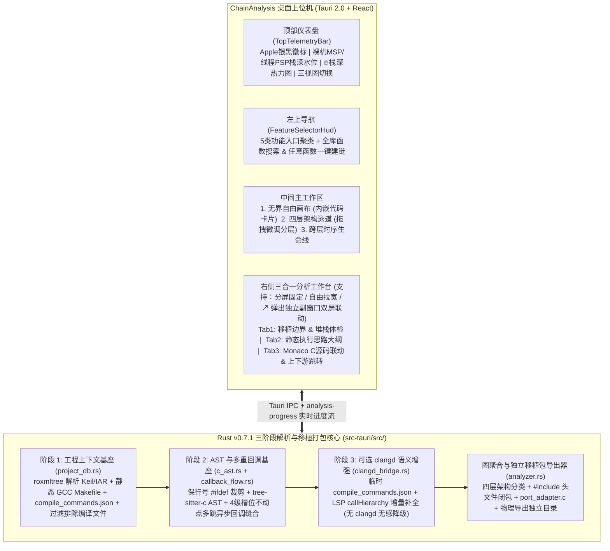

# ChainAnalysis v0.7.1 — 嵌入式 C/C++ 源码调用链、多重异步回调、堆栈体检与移植边界分析上位机

<p align="center">
  
</p>

> **核心定位**：一款专为**嵌入式研发工程师**打造的源码学习、架构梳理与跨平台代码迁移（Porting）辅助桌面上位机。
> **核心哲学**：**0 编译环境依赖**（残缺工程或缺头文件也能秒级静态解析）、**0 强制 AI API Key 绑定**（纯静态 AST 与图算法 100% 离线可用 + 一键生成 AI 深度移植 Prompt）、**以“业务功能”为视角**还原完整调用链、多重异步回调、最坏栈深（WCS）以及跨芯片移植依赖边界。
> **📖 核心解析思路与实现方法技术文档**：详见 [README_zh.md](./README_zh.md)（完整拆解 v0.7.1 三阶段解析基座：Keil/IAR/Makefile/GCC 工程上下文、`tree-sitter-c` AST + `#ifdef` 裁剪、多重异步回调不动点追踪、以及可选 `clangd` LSP 语义增强）。

---

## 一、 工具用途：解决什么核心痛点？

在嵌入式开发（如 STM32 / GD32 / ESP32 / RISC-V 驱动移植、开源协议栈如 **CherryUSB / LwIP / FatFs / LittleFS / FreeModbus** 二次开发、接手大型遗留固件）中，工程师最痛苦的往往不是写代码，而是：

1. **回调函数与函数指针导致“跳转断链”**：
   - 传统 IDE（Keil / IAR / VS Code / Source Insight）点击 `Go to Definition` 遇到 `intf->class_interface_handler()`、`s_flash_ops->write()`、`rx_msg[ep].cb()` 或 `__WEAK` 弱函数时直接断掉，人脑极易在多层异步中断回调中迷失。
2. **全量调用图“像蜘蛛网一样没法看”**：
   - Doxygen 等传统工具生成的是全库几千个函数的蜘蛛网，而学习与移植真正需要的是**“先告诉我这个工程有哪几个功能，点进某一个功能，只给我看这个功能的主干调用链、回调闭环和设计思路”**。
3. **不知道某个模块“能不能直接搬到裸机”以及“需要改哪些底层接口”**：
   - 想要把开源库里的某一个功能（如 USB CDC 虚拟串口、MSC 虚拟 U 盘、Ymodem OTA）抠出来搬到自己的项目里，不知道要拷哪几个 `.c/.h` 文件、依赖了哪些全局变量、需不需要 RTOS、要重写哪几个硬件底层接口。
4. **移植后莫名其妙 HardFault（爆栈）**：
   - 嵌入式 MCU 的 RAM 极其有限（裸机 MSP 主栈往往只有 `1KB ~ 2KB`，RTOS 任务栈只有 `512B ~ 2KB`）。如果移植过来的某个深层函数里随手声明了 `uint8_t pkt_buf[1024]` 或存在隐蔽的跨回调递归，极易在中断嵌套时发生栈溢出。

**ChainAnalysis** 正是为了彻底解决上述 4 大痛点而生。

---

## 二、 核心功能与设计思路

### 1. 嵌入式 5 类“功能入口”自动聚类 + 全库任意函数一键建链
导入任意本地 C/C++ 文件夹后，无需人工配置，自动按嵌入式拓扑特征提炼出 5 类功能入口：
- ⚡ **硬件中断入口 (`ISR`)**：自动识别 `*_IRQHandler`、中断服务函数及底层中断分发链。
- 🔄 **RTOS 任务线程 (`RTOS_TASK`)**：自动识别 `xTaskCreate`、`usb_osal_thread_create`、`rt_thread_create`、`osThreadNew` 等任务入口及分配栈大小。
- 🚀 **主循环与初始化 (`MAIN_LOOP`)**：自动识别 `main()` 及模块级 `*_init()` 注册与启动流程。
- 📦 **模块对外核心 API (`PUBLIC_API`)**：按模块聚类对外暴露的核心协议/算法入口。
- 🎛️ **命令表与状态跳转表 (`CMD_TABLE`)**：识别 CLI/Shell 命令表（如 `lsusb`、AT 指令表）挂载的入口。
- 🎯 **全库搜索与任意函数自定义建链**：支持在左上角搜索全库任意函数，一键**向上追溯调用/触发它的父函数 + 向下展开全部子调用与回调树**。

### 2. C 语言 3 类“隐式回调”与多重异步回调自动缝合引擎（v0.7.1 升级）
除了普通直接函数调用（实线），专门针对嵌入式 C 语言常用的 3 种解耦套路与多层异步注册建立**发光彩色虚线**（完整算法详见 [README_zh.md](./README_zh.md)）：
- 🔌 **结构体函数指针 / 驱动接口表 (`[OPS_TABLE]` · 青色虚线)**：自动扫描 `.field = func`、顺序/指定结构体初始化与 `ptr->field = func` 赋值，并与 `->field()` 调用点跨文件自动配对（如 `s_flash_ops->write()` ➔ `BSP_Flash_Program`、`phost->class_cb->Machine()` ➔ `USBH_HID_Handle`）。
- ⚡ **多重异步回调数据流追踪 (`[ASYNC_CALLBACK]` · 橙色虚线)**：基于 `tree-sitter-c` AST 与 4 级槽位不动点传播（`callback_flow.rs`），自动追踪**多层封装注册**（如 `main → drv_register_rx → dma_ll_bind_rx → g_bus.rx_cb`）、**配置结构体槽位拷贝**（如 `ep->ep_cb → rx_msg[ep].cb`）以及**回调内再注册二级回调**的嵌套异步链，并在边上完整标注多跳注册溯源路径。
- 🟣 **弱函数覆盖 (`[WEAK_OVERRIDE]` · 紫色虚线)**：识别 `__WEAK` / `__weak` 符号（如 STM32 HAL 库回调或 CherryUSB 的 `__WEAK usbd_msc_sector_read`），自动关联重写点并标记为移植钩子。

### 3. 裸机 (Bare-Metal) vs RTOS 自动探测 + 最坏峰值栈深 (WCS) 分析
- **🟢 裸机可用 (0 OS) vs 🔵 需 RTOS/OSAL 自动判定**：
  - 自动扫描整条功能调用链是否调用了任何 RTOS 线程/信号量/消息队列 API。
  - 若无任何 OS 依赖，直接亮起 **`🟢 裸机可用 (0 OS)`** 通行证，切换为 **【裸机启动主栈 (MSP `startup_*.s / .ld`) 水位评估】**；
  - 若检测到 OS 原语调用，亮起 **`🔵 需 RTOS/OSAL`**，切换为 **【RTOS 线程栈 (PSP) 配额评估】**，并提示如何改造为裸机状态机轮询。
- **单函数局部栈帧与大数组精准捕捉**：
  - 自动扫描函数体内的局部变量、形参、一维/多维数组（支持 `#define` 宏常量求值，如 `uint8_t pkt_buf[YMODEM_PACKET_1K_SIZE]`）及自定义结构体大小。对大栈帧（$\ge 128\text{B}/256\text{B}$）和变长数组（VLA）标红预警。
- **🔥 调用链最坏峰值栈深 (WCS) 热力图 & 🔄 递归环检测**：
  - 在调用子图上搜索累计耗栈最大的最坏路径，开启 **`[🔥 栈深热力图]`** 后在画布上用霓虹粗红线一键点亮爆栈风险路径；
  - 利用 DFS 回边检测直接递归（如 `usbh_list_device` 级联 Hub 递归）或跨回调的间接递归环路（紫色闪烁告警）。
- **📏 支持导入 GCC `.su` (`-fstack-usage`) 栈文件校准**：
  - 支持粘贴编译器生成的 `.su` 文件内容，用汇编级精确栈帧字节数覆盖 AST 静态估算值。

### 4. 三维可视化视图一键切换
1. **无界自由画布（方案二）**：全屏深色点阵画布 + 智能函数卡片（支持点击 `</>` **在卡片内原地展开 10 行核心 C 代码切片**，支持点击 `+N` 逐层折叠/展开子树，间距宽敞不遮挡连线路径）。
2. **嵌入式四层架构泳道（方案三 · 移植专用）**：
   - 自动将所有函数按启发式规则落入 4 条水平架构泳道：
     - `L1 · 应用与任务层 (APP)` — 业务调用参考
     - `L2 · 核心模块与协议层 (CORE)` — **📦 核心搬迁区（原样打包带走）**
     - `L3 · 事件与回调总线 (CALLBACK)` — **⚡ 异步中断与解耦桥梁**
     - `L4 · 硬件抽象与驱动层 (HAL / BSP / DCD / OS)` — **🔌 移植替换边界（跨芯片必须重写或适配）**
   - **支持鼠标上下拖拽函数卡片跨泳道微调**，右侧【需替换的底层接口】与【必拷文件清单】实时联动重算！
3. **跨层时序生命线视图（Sequence Lifeline）**：
   - 将 L1~L4 作为 4 条垂直生命线，按执行先后顺序展示每一步跨层调用与**`◀ 底层反向异步回调上抛`**，并在右侧同步展示每一步压栈后的**累计栈深水位**。

### 5. 一键抠出独立移植源码包 + 自动生成 `port_adapter.c` 适配层
- **必拷文件与 `#include` 头文件级联闭包**：自动递归追踪 `.c` 文件包含的所有内部 `.h` 头文件，确保移植不漏文件。
- **🛠️ 一键生成移植适配层 C 代码 (`port_<feature>_adapter.c`)**：自动把当前功能落在 `L4 HAL` 层的全部底层接口与 `__WEAK` 钩子生成带注释、调用方说明和 `TODO` 空壳实现的标准 `.c` 源文件。
- **📦 一键导出纯净版独立移植文件夹**：直接从原仓库把该功能所需的全部 `.c/.h` 核心文件、`port_adapter.c` 适配层骨架与 `PORTING_CHECKLIST.md` 按目录结构物理拷贝到独立文件夹，可直接拉进新项目的 Keil / IAR / CMake 编译！

---

## 三、 技术栈与框架选型

本项目采用 **Tauri 2.0 (Rust) + React 19 (TypeScript)** 架构，编译出的 Windows 原生桌面上位机单文件仅 ~17 MB，无任何外部运行时依赖，且所有缓存与构建配置均位于非系统盘（D 盘）：

| 层级 | 采用框架 / 工具库 | 版本 | 核心职责与选型优势 |
| :--- | :--- | :---: | :--- |
| **桌面上位机框架** | **Tauri 2.0** (`tauri`, `tauri-plugin-dialog`) | `2.12` | 原生 Windows WebView2 渲染，体积小、启动快、支持原生多窗口联动与系统级文件夹选择框，无 CMD 黑窗 |
| **后端三阶段解析引擎** | **Rust** (`roxmltree`, `tree-sitter-c`, `encoding_rs`, `walkdir`, `serde_json`, LSP JSON-RPC) | `1.98` | 阶段 1 统一工程上下文（Keil/IAR/Makefile/GCC/`compile_commands.json`）+ 阶段 2 `tree-sitter-c` AST / 保行号 `#ifdef` 裁剪 / 多重异步回调追踪 + 阶段 3 可选 `clangd` LSP 语义增强（无 `clangd` 自动无感降级） |
| **前端 UI 框架** | **React + TypeScript + Vite** | `19.1` / `6.4` | 组件化响应式开发，同时支持 Tauri 桌面端独立运行与本地 Web (`localhost:1420`) 预览 |
| **样式与视觉设计** | **TailwindCSS v4 + Lucide Icons** | `4.1` | Apple 深空黑 + 液态铂金银金属质感徽标、毛玻璃 (`backdrop-blur`) HUD 悬浮面板 |
| **图可视化与自动布局** | **React Flow (`@xyflow/react`) + Dagre (`@dagrejs/dagre`)** | `12.6` / `1.1` | 高性能自定义函数卡片、动态流动回调虚线、Dagre 宽间距自动分层布局与四层架构泳道拖拽交互 |
| **状态管理与双窗通信** | **Zustand + `BroadcastChannel` API** | `5.0` | 集中管理工程图数据与视图状态，实现主画布窗口与**`[↗ 独立成窗]`**源码副窗口之间的毫秒级双向同步 |
| **源码联动阅读器** | **Monaco Editor (`@monaco-editor/react`)** | `4.7` | VS Code 同款编辑器内核，支持 C/C++ 语法高亮、函数行区间精准跳转高亮、全库文件自由切换阅读 |

---

## 四、 系统架构图



---

## 五、 快速使用指南

### 方式 1：直接双击运行原生桌面上位机（推荐）
直接双击工程根目录下的可执行文件即可启动（无任何控制台黑窗，无需启动命令行）：
- 👉 **`d:\13_JBYWorkSpace\ChainAnalysis\ChainAnalysis_App.exe`**

### 方式 2：7 步完成一个嵌入式工程/协议栈的学习与移植
1. **加载工程**：
   - 软件启动默认自动加载本机的 `D:\3-code\USB\CherryUSB-1.6.1`；
   - 点击左上角 **`[切换工程]` ➔ `[📁 浏览...]`**，可弹出 Windows 原生文件夹选择框，选择你电脑上的任意嵌入式 C/C++ 工程目录，实时进度条走完即可完成静态解析。
2. **选择功能或搜索任意函数建链**：
   - 在左上角列表中点击自动识别出的功能入口（如 `USBD_IRQHandler`、`cdc_acm_init`、`usbh_hub_thread`、`mass_storage_bulk_out`）；
   - 或者在左上角搜索框输入任意函数名（如 `dfu`、`audio`、`hid`），点击 **`[🎯 生成此函数调用链]`** 查看其完整上下游关系。
3. **查看代码切片与完整源码联动**：
   - 点击画布卡片右上角的 **`</>`** 按钮，直接在卡片内原地展开核心 C 代码切片；
   - **双击任意函数卡片**，右侧 `</> 源码联动` 自动打开对应 `.c` 文件并高亮定位到该函数行；通过源码上方的 **`↑ 调用方 / ↓ 子调用`** 胶囊或 **`📄 浏览工程文件`** 下拉框可连续跳转阅读。
4. **解放视野（分屏调宽 / ↗ 独立成窗）**：
   - 拖动右侧栏左边缘可自由拉宽源码区；
   - 点击右侧栏顶部的 **`[↗ 独立成窗]`**，可将右侧源码与移植分析台弹出为独立副窗口（主窗口 100% 展示大图，双窗口点击实时双向联动）。
5. **排查爆栈与递归隐患**：
   - 查看顶部状态栏的 **`🟢 裸机可用 (0 OS)` / `🔵 需 OSAL/RTOS`** 标签及栈深百分比；
   - 点击顶部 **`[🔥 栈深热力图]`**，画布立刻用粗红线高亮最坏情况最大栈深（WCS）路径；若有 GCC `.su` 文件，可在右侧点击 **`[.su 校准]`** 导入精确栈帧。
6. **切到【四层泳道】与【时序生命线】理清移植边界**：
   - 点击顶部 **`[四层泳道(移植)]`**，一眼看清哪些文件属于 `L2 核心搬迁区`、哪些函数落在了 `L4 HAL/BSP 移植替换边界`（支持上下拖动卡片手动微调分层）；
   - 点击顶部 **`[时序生命线]`**，按时间顺序查看调用与底层反向异步回调的交互步骤及单步累计栈深。
7. **一键导出适配层 `.c` 骨架与独立移植源码包**：
   - 在右侧【移植边界 & 堆栈】页签点击 **`[🛠️ 生成适配层 .c 模板]`**，即可复制或下载自动生成的 `port_<feature>_adapter.c`；
   - 切换到弹窗第 2 个页签 **`[2. 一键提取独立移植源码包]` ➔ `[立即导出到磁盘]`**，系统会自动把该功能所需的全部 `.c/.h` 源文件（含级联 `#include` 头文件）、适配层 `.c` 代码及 `PORTING_CHECKLIST.md` 打包导出到 `exported_ports/port_<feature>/` 目录！
   - 若需要大模型撰写详细移植教程，点击右上角 **`[导出 AI Prompt]`** 一键复制结构化上下文粘贴到任何免费网页 AI 即可。

---

## 六、 开发者命令参考

如果你需要修改前端界面或 Rust 解析规则并重新编译：

```powershell
# 1. 启动 Web 开发热更新服务 (浏览器访问 http://127.0.0.1:1420/)
npm run dev

# 2. 重新生成 Apple 银黑金属风三环拓扑多尺寸图标 (.ico / .png)
node scripts/generateAppleLogo.mjs

# 3. 编译内嵌前端资源的 Release 独立桌面版 .exe
npx tauri build --no-bundle
Copy-Item -Force "src-tauri\target\release\chain-analysis.exe" "ChainAnalysis_App.exe"
```

---

## 七、 工程目录结构

```text
ChainAnalysis/
├── ChainAnalysis_App.exe              # 编译好的 Windows 原生独立桌面上位机程序（Release 双击即用）
├── README.md                          # 项目总览与使用文档
├── README_zh.md                       # v0.7.1 核心解析思路、多重异步回调与三阶段架构技术文档
├── ARCHITECTURE_AND_PLAN.md           # 初期架构设计与四阶段规划蓝图存档
├── package.json                       # 前端依赖与脚本配置
├── vite.config.ts                     # Vite 配置与本地开发态 API 中间件
├── public/
│   └── logo.svg                       # Apple 银黑金属质感三环分支拓扑矢量 Logo
├── scripts/
│   └── generateAppleLogo.mjs          # 纯 Node 超采样抗锯齿多尺寸 PNG & ICO 图标生成器
├── src/                               # 前端 React + TypeScript 源码
│   ├── App.tsx                        # 主工作台布局、双窗口同步与全局解析进度条
│   ├── types/analysis.ts              # 前后端统一图分析、堆栈与移植边界数据模型
│   ├── store/useChainStore.ts         # Zustand 全局状态、自定义函数建链、.su 校准与 BroadcastChannel 同步
│   ├── utils/
│   │   ├── graphMetrics.ts            # WCS 最坏栈深算法、递归环检测、#include 移植闭包与 C 适配层代码生成器
│   │   └── layoutEngine.ts            # Dagre 宽间距自动布局与嵌入式四层架构泳道布局引擎
│   ├── components/
│   │   ├── canvas/
│   │   │   ├── ChainCanvas.tsx        # React Flow 主画布与泳道拖拽重分层控制器
│   │   │   ├── SmartFunctionNode.tsx  # 智能函数卡片（支持内嵌代码切片展开、栈消耗角标与子树折叠）
│   │   │   ├── SwimlaneBandNode.tsx   # L1~L4 嵌入式四层架构泳道背景组件
│   │   │   └── SequenceTimelineView.tsx # 跨层时序生命线与单步累计栈深视图
│   │   ├── hud/
│   │   │   ├── TopTelemetryBar.tsx    # 顶部悬浮堆栈体检仪表盘与三视图切换栏
│   │   │   ├── FeatureSelectorHud.tsx # 左上 5 类功能入口导航与全库函数搜索建链面板
│   │   │   ├── OpenProjectModal.tsx   # 工程目录加载器（带实时进度条与原生文件夹浏览）
│   │   │   ├── PortingCodeModal.tsx   # 适配层 .c 代码生成、独立移植包物理导出与 GCC .su 校准弹窗
│   │   │   └── AiPromptModal.tsx      # 免 API Key 的 AI 深度移植 Prompt 预览与一键复制弹窗
│   │   └── drawer/
│   │       └── RightAnalysisDrawer.tsx # 右侧三合一分析台（支持分屏固定/自由拉宽/独立弹出成窗/源码上下游跳转）
│   └── data/demoProject.ts            # 内置 STM32F4 + FreeRTOS + Ymodem/FOC/AT 演示数据集
└── src-tauri/                         # Tauri 2.0 Rust 原生后端
    ├── Cargo.toml                     # Rust 依赖与正则性能优化配置
    ├── tauri.conf.json                # 桌面窗口尺寸、暗色主题与多尺寸图标打包配置
    ├── icons/                         # 16x16 ~ 256x256 全尺寸 Windows .ico 与 .png 图标
    └── src/
        ├── main.rs                    # Windows GUI 子系统入口（隐藏 CMD 控制台黑窗）
        ├── lib.rs                     # Tauri 原生异步命令注册、clangd 探测接口与多窗口管理
        ├── project_db.rs              # 阶段 1：Keil/IAR/Makefile/GCC/compile_commands.json 统一工程基座
        ├── c_ast.rs                   # 阶段 2：保行号 #ifdef 裁剪 + tree-sitter-c 容错 AST 解析器
        ├── callback_flow.rs           # 阶段 2：4 级槽位不动点传播的多重异步回调追踪引擎
        ├── clangd_bridge.rs           # 阶段 3：可选本机 clangd LSP 语义增强桥接层（含无感降级）
        └── analyzer.rs                # 总编排流水线、四层分类、堆栈估算、实时进度推送与独立移植包导出
```
